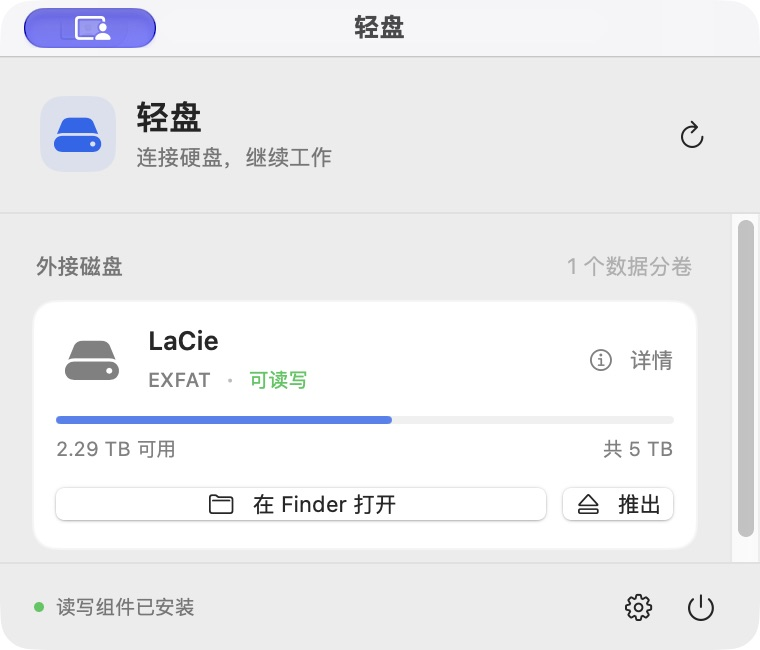
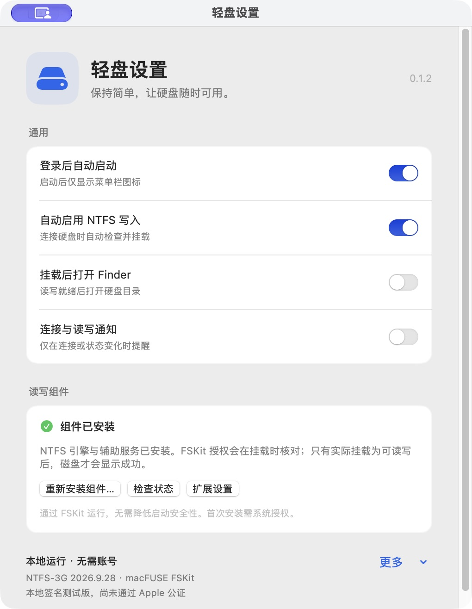

# light-disk / 轻盘

🌐 [中文](README.md) · **English**

A lightweight macOS menu bar utility that enables NTFS read/write access and lets you copy, paste and drag files in Finder.

**Open-source Beta · Apple Silicon · Ad-hoc signed, not notarized by Apple.** The application UI is currently Chinese; these English documents explain installation and operation.

[Download Beta](https://github.com/AnthonyChenny/light-disk/releases) · [Installation](docs/INSTALL.en.md) · [Build](docs/BUILD.en.md) · [Release guide](docs/RELEASING.en.md) · [Report an issue](https://github.com/AnthonyChenny/light-disk/issues)

## Screenshots




These are real screenshots from 0.1.2. The public Beta retains this interface. The local-signing notice shown in the UI accurately describes the Beta signing status.

## Features

- Automatically mount NTFS read/write and copy files in both directions in Finder.
- Use native macOS support for exFAT, FAT32, APFS and HFS+.
- View capacity, access state and disk details; safely eject disks. About four normal cards fit on a regular screen.
- Optional launch at login. No account, advertising, telemetry or cloud sync.
- NTFS-3G with the macFUSE FSKit backend; no automatic kernel-extension fallback. Unsafe volumes are not taken over for writing.

## Requirements

| Item | Status |
|---|---|
| CPU | Apple Silicon (M series) only; no Intel installer |
| macOS | Deployment target 15.4+; full local validation on 27.0.1; other versions unverified |
| Dependency | macFUSE 5.5.0, installed separately from the vendor |
| Signing | Ad-hoc; no Developer ID or Apple notarization |
| Excluded | BitLocker unlocking, partitioning, formatting, automatic repair, ext4 |

## First installation: download, install, then connect

**For a first-time setup, download only the two DMGs below. You do not need source code or other release attachments.** Install macFUSE first: it connects NTFS-3G to macOS. NTFS-3G is already included in the light-disk installer; there is no separate engine download.

| Order | File | Download |
|---|---|---|
| ① | Official `macfuse-5.5.0.dmg` | [Download macFUSE](https://github.com/macfuse/macfuse/releases/download/macfuse-5.5.0/macfuse-5.5.0.dmg) ([official release](https://github.com/macfuse/macfuse/releases/tag/macfuse-5.5.0)) |
| ② | `light-disk-0.1.3-beta.1-arm64.dmg` | [Download light-disk](https://github.com/AnthonyChenny/light-disk/releases/download/v0.1.3-beta.1/light-disk-0.1.3-beta.1-arm64.dmg) ([project release](https://github.com/AnthonyChenny/light-disk/releases/tag/v0.1.3-beta.1)) |

### Step 1: Install macFUSE

In **Finder → Downloads**, open `macfuse-5.5.0.dmg`, then double-click the **macFUSE `.pkg` installer inside**. Follow Continue → Install, and authenticate with your Mac administrator password or Touch ID in the system dialog. Restart first if the installer requests it. Skip reinstalling if 5.5.0 is already installed. You do not need `debug.tbz`, `sha256`, `sig` or `Source code` from the vendor's page.

### Step 2: Enable both macFUSE extensions

Open **System Settings → General → Login Items & Extensions → File System Extensions**. Enable **macFUSE** and **macFUSE (local)**, preferably through the “By Category” view. light-disk uses FSKit: **Recovery Mode and reduced startup security are not needed**. If the entry is missing or toggles do not respond, see the [full installation guide](docs/INSTALL.en.md#if-extension-switches-do-not-respond).

### Step 3: Install light-disk

Open `light-disk-0.1.3-beta.1-arm64.dmg` and double-click **`安装轻盘.pkg`** (Install QingPan) inside. Follow Continue → Install and authenticate. This installs the App in Applications, together with the engine and helper. Do not just drag an App; you do not need a second standalone `.pkg` download.

### Step 4: Authorize disk access

Open **System Settings → Privacy & Security → Full Disk Access**. Click **`+`**, press **`⌘⇧G`** in the file chooser, paste this path and press Return:

```text
/Library/PrivilegedHelperTools/local.qingpan.helper
```

Select the file, add it and switch it on. Authenticate in the system dialog if needed. Also allow the App's removable-volume prompt, or check Privacy & Security → Files & Folders → 轻盘 → Removable Volumes. Full Disk Access is a broad system permission; review it before granting it.

### Step 5: Launch and connect

Open **Finder → Applications → 轻盘**, click its disk icon in the top menu bar and connect your NTFS drive. Wait for **`可读写`** (read/write ready), then copy, paste or drag files in Finder. Click **`推出`** (Eject) and wait for completion before unplugging.

**If macOS cannot verify the developer or blocks opening:** this Beta is ad-hoc signed and not notarized. Verify the download source, then review System Settings → Privacy & Security and use Open Anyway if offered. If unavailable, stop and report the issue; do not disable Gatekeeper or SIP. [Troubleshooting, upgrade and uninstall](docs/INSTALL.en.md)

## Open source and releases

The original Swift code is [MIT-licensed](LICENSE). NTFS-3G and our modifications retain their GPL/LGPL terms. macFUSE is a separate dependency with its own license, including restrictions on commercial binary bundling. **MIT does not cover the entire dependency collection.** See [THIRD_PARTY_NOTICES.md](THIRD_PARTY_NOTICES.md).

The only manually uploaded Release attachment is the DMG for end users. GitHub automatically provides two `Source code` archives for developers, including the tagged engine source, modifications and build scripts; they are not installation downloads. The hash is in the release notes. Local build/audit files remain in ignored `dist/`. [Current release notes](docs/releases/v0.1.3-beta.1.md)

## Validation and limitations

Earlier local builds passed disposable NTFS/exFAT image tests, a file larger than 4 GiB, 16 MiB round trips on two physical NTFS drives, and UI/eject checks. This public Beta adds documentation and packaging on that foundation. **A clean installation on another Mac is not yet validated.** Sleep/wake, power interruption and all OS versions remain unverified. See [test coverage](docs/TESTING.md).

Start with disposable data on your own setup and keep separate backups of important data. Hibernated, dirty or busy volumes are not forcibly repaired or unmounted. The NTFS engine cannot enumerate a USB disk that macOS itself does not detect.

## Contributing

Read [CONTRIBUTING.md](CONTRIBUTING.md) and [SECURITY.md](SECURITY.md). Include OS version, chip, filesystem and sanitized errors in reports. Do not upload file contents, complete disk serials or passwords.

## Buy me a coffee ☕

If light-disk has been useful to you, you're welcome to buy me a coffee. No pressure—a star or a little feedback is just as appreciated.

If you'd like to treat me to a coffee, scan the QR code below with Alipay. Thanks for your support!


