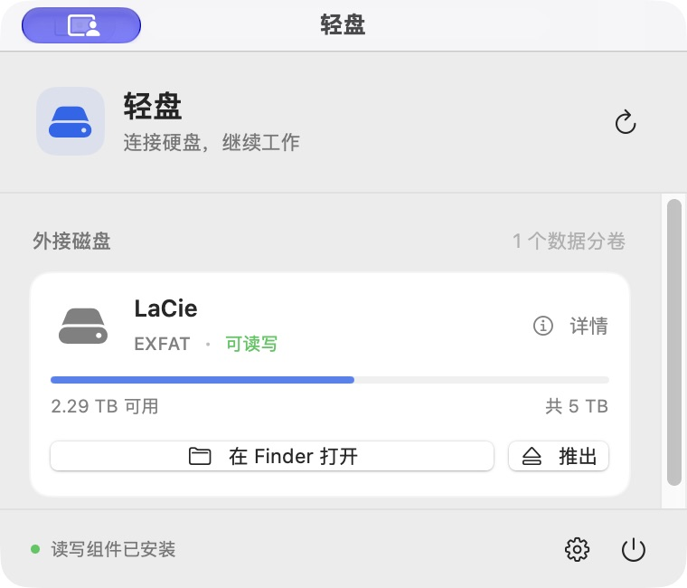

# light-disk / 轻盘

🌐 **中文** · [English](README.en.md)

一个轻量的 macOS 菜单栏硬盘工具：连接 NTFS 硬盘后启用读写，在 Finder 中复制、粘贴和拖放文件。

**开源 Beta · Apple Silicon · 本地临时签名，尚未经过 Apple 公证。** 当前应用界面为中文；英文文档提供完整安装和操作指引。

[下载 Beta](https://github.com/AnthonyChenny/light-disk/releases) · [安装指南](docs/INSTALL.zh-CN.md) · [构建指南](docs/BUILD.zh-CN.md) · [发布指南](docs/RELEASING.zh-CN.md) · [反馈问题](https://github.com/AnthonyChenny/light-disk/issues)

## 界面

以上为真实运行截图。截图来自 0.1.2，公开 Beta 沿用该界面；界面中出现的“本地签名测试版”与 Beta 的签名状态一致。

## 功能

- NTFS 自动挂载读写，支持 Finder 双向复制。
- exFAT、FAT32、APFS、HFS+ 使用 macOS 原生支持。
- 菜单栏查看容量、读写状态、磁盘详情和安全推出；普通屏幕约显示四张卡片。
- 可选登录后自动启动，无账号、广告、遥测或云同步。
- NTFS-3G + macFUSE FSKit，不自动回退到内核扩展；异常卷停止写入接管。

## 支持范围

| 项目 | 当前状态 |
|---|---|
| 处理器 | 仅 Apple Silicon（M 系列），没有 Intel 安装包 |
| 系统 | 构建目标 macOS 15.4+；实际完整验证 macOS 27.0.1，其他版本待测试 |
| 必需组件 | macFUSE 5.5.0（单独从官方安装） |
| 签名 | ad-hoc 临时签名，无 Developer ID / Apple 公证 |
| 不包含 | BitLocker 解锁、分区、格式化、自动修复、ext4 |

## 首次安装：请按顺序完成

**macFUSE → 启用 FSKit 扩展 → 轻盘安装包 → 磁盘访问授权 → 连接硬盘。**

1. **先装 macFUSE。** 从 [macFUSE 官方网站](https://macfuse.github.io/) 或 [5.5.0 官方发布页](https://github.com/macfuse/macfuse/releases/tag/macfuse-5.5.0)下载安装器。本项目的 DMG **不附带、不自动下载安装 macFUSE**。
2. **启用文件系统扩展。** 在「系统设置 → 通用 → 登录项与扩展 → 文件系统扩展」启用 `macFUSE` 与 `macFUSE (local)`。优先使用“按类别”视图。轻盘使用 FSKit，无需进入恢复模式降低启动安全性。
3. **安装轻盘。** 从本仓库 Releases 下载 `light-disk-0.1.3-beta.1-arm64.dmg`，打开后运行 `安装轻盘.pkg`，在系统窗口完成管理员认证。安装包会安装 App、NTFS-3G 和受限辅助服务，**不能只复制 App**。
4. **授予磁盘访问权限。** 「系统设置 → 隐私与安全 → 完全磁盘访问权限」添加并启用 `/Library/PrivilegedHelperTools/local.qingpan.helper`。文件选择窗口可用 `⌘⇧G` 输入路径。完全磁盘访问是较广的权限，用于辅助服务读取实盘；请审核后决定。在系统询问轻盘访问可移动卷时允许，或在「文件与文件夹」开启其可移除宗卷权限。
5. **打开轻盘并连接硬盘。** 从「应用程序」启动，点菜单栏硬盘图标；只有卡片显示「可读写」才表示写入已启用。文件操作直接在 Finder 完成，拔线前点「推出」。

下载的 Beta 可能被 Gatekeeper 拦截。确认来自本仓库并核对 SHA-256 后，可在系统「隐私与安全」中审核并选择“仍要打开”；若系统不提供此选项请停止并反馈。不需要关闭 Gatekeeper 或 SIP。[完整安装、升级与卸载指南](docs/INSTALL.zh-CN.md)

## 开源与发布

自写 Swift 代码采用 [MIT](LICENSE)。NTFS-3G 及其修改保留各自 GPL/LGPL 许可；macFUSE 是独立依赖，具有包括商业二进制捆绑限制在内的单独许可。**MIT 不适用于整个依赖集合**。详见 [THIRD_PARTY_NOTICES.md](THIRD_PARTY_NOTICES.md)。

每个 Release 应同时提供 DMG、对应源码 ZIP、SHA256SUMS.txt；请使用带 `beta` 的标签并勾选 GitHub 的 **This is a pre-release**。当前目录内 `dist/` 是本地待上传资产，不随 Git 提交。[当前版本说明](docs/releases/v0.1.3-beta.1.md)

## 验证与限制

原本机版本验证过 NTFS/exFAT 测试镜像、超过 4 GiB 文件、两块真实 NTFS 盘的 16 MiB 双向摘要，以及详情、四卡片布局和推出反馈。公开 Beta 在此基础上整理文档及打包，**尚未在另一台干净的 Mac 完成首装验收**，也尚未完整验证睡眠唤醒、断电或所有系统版本。[验证记录](docs/TESTING.md)

先用可丢弃数据验证你的设备；重要数据保留独立备份。检测到休眠、脏卷或占用时不会强制卸载或删除休眠文件。系统根本未识别硬盘时，NTFS 引擎无法代替 USB 连接识别。

## 参与

请查看 [贡献指南](CONTRIBUTING.md) 和 [安全策略](SECURITY.md)。报告问题请附系统版本、芯片、格式及脱敏错误信息；不要上传文件内容、完整磁盘序列号或密码。

## 请作者喝杯咖啡 ☕

如果轻盘刚好帮到了你，也欢迎请作者喝杯咖啡。随意就好，点个 Star、提条建议，同样很开心。

想聊聊轻盘，或者请杯咖啡，可以扫码加我微信：

