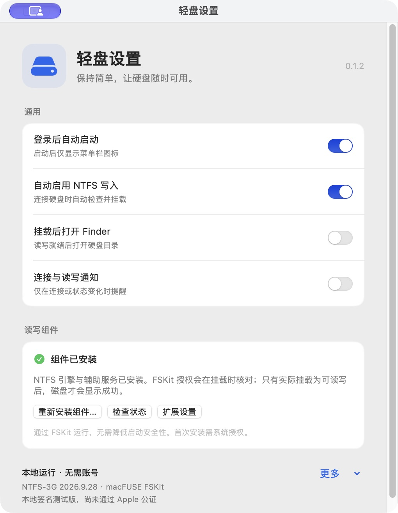

# light-disk / 轻盘

🌐 **中文** · [English](README.en.md)

一个轻量的 macOS 菜单栏硬盘工具：连接 NTFS 硬盘后启用读写，在 Finder 中复制、粘贴和拖放文件。

**开源 Beta · Apple Silicon · 本地临时签名，尚未经过 Apple 公证。** 当前应用界面为中文；英文文档提供完整安装和操作指引。

[下载 Beta](https://github.com/AnthonyChenny/light-disk/releases) · [安装指南](docs/INSTALL.zh-CN.md) · [构建指南](docs/BUILD.zh-CN.md) · [发布指南](docs/RELEASING.zh-CN.md) · [反馈问题](https://github.com/AnthonyChenny/light-disk/issues)

## 界面




以上为真实运行截图。截图来自 0.1.2，公开 Beta 沿用该界面；界面中出现的“本地签名测试版”与 Beta 的签名状态一致。

## 功能

- NTFS 自动挂载读写，支持 Finder 双向复制。
- exFAT、FAT32、APFS、HFS+ 使用 macOS 原生支持。
- 菜单栏查看容量、读写状态、磁盘详情和安全推出；普通屏幕约显示四张卡片。
- 可选登录后自动启动，无账号、广告、遥测或云同步。
- NTFS-3G + macFUSE FSKit，不自动回退到内核扩展；异常卷停止写入接管。

## 支持范围

| 项目 | 当前状态 |
|---|---|
| 处理器 | 仅 Apple Silicon（M 系列），没有 Intel 安装包 |
| 系统 | 构建目标 macOS 15.4+；实际完整验证 macOS 27.0.1，其他版本待测试 |
| 必需组件 | macFUSE 5.5.0（单独从官方安装） |
| 签名 | ad-hoc 临时签名，无 Developer ID / Apple 公证 |
| 不包含 | BitLocker 解锁、分区、格式化、自动修复、ext4 |

## 首次安装：从下载到使用

**第一次使用，只需下载下面两个 DMG；不需要下载源码或其他附件。** macFUSE 是轻盘写入 NTFS 所需的底层组件，要先安装；NTFS-3G 已包含在轻盘安装包里，不用另找。

| 顺序 | 下载什么 | 点击下载 |
|---|---|---|
| ① | 官方 macFUSE 5.5.0，文件名 `macfuse-5.5.0.dmg` | [下载 macFUSE](https://github.com/macfuse/macfuse/releases/download/macfuse-5.5.0/macfuse-5.5.0.dmg)（[官方发布页](https://github.com/macfuse/macfuse/releases/tag/macfuse-5.5.0)） |
| ② | 轻盘 Beta，文件名 `light-disk-0.1.3-beta.1-arm64.dmg` | [下载轻盘](https://github.com/AnthonyChenny/light-disk/releases/download/v0.1.3-beta.1/light-disk-0.1.3-beta.1-arm64.dmg)（[本项目发布页](https://github.com/AnthonyChenny/light-disk/releases/tag/v0.1.3-beta.1)） |

### 第一步：安装 macFUSE

下载完成后，打开“访达 → 下载”，双击 `macfuse-5.5.0.dmg`，再双击里面的 **macFUSE 安装包（`.pkg`）**。按“继续 → 安装”完成，出现认证时在系统窗口输入 Mac 管理员密码或使用 Touch ID。如安装器要求重启，先重启再继续。已经装好 5.5.0 的用户可跳过重复安装。官方页面中的 `debug.tbz`、`sha256`、`sig` 和 `Source code` 都不是普通用户要安装的文件。

### 第二步：打开 macFUSE 的两个扩展

打开 **系统设置 → 通用 → 登录项与扩展 → 文件系统扩展**，启用 **macFUSE** 和 **macFUSE (local)**；优先使用“按类别”入口。轻盘使用 FSKit 模式，**不用进入恢复模式或降低启动安全性**。若找不到入口或开关无反应，见[完整安装指南](docs/INSTALL.zh-CN.md#补充扩展开关没有反应)。

### 第三步：安装轻盘

双击 `light-disk-0.1.3-beta.1-arm64.dmg`，再双击里面的 **`安装轻盘.pkg`**，按“继续 → 安装”完成管理员认证。这一步会把轻盘放进“应用程序”，并安装 NTFS 引擎和辅助服务。不要只找一个 App 拖过去；也不需要重复下载独立 `.pkg`。

### 第四步：允许轻盘访问硬盘

打开 **系统设置 → 隐私与安全 → 完全磁盘访问权限**，点击 **`+`**，在文件选择窗口按 **`⌘⇧G`**，粘贴下面这条路径并回车：

```text
/Library/PrivilegedHelperTools/local.qingpan.helper
```

选中该文件，添加并打开开关。若系统要求认证，在系统窗口完成。首次启动轻盘若询问访问可移动卷，也请允许；可在“隐私与安全 → 文件与文件夹 → 轻盘 → 可移除的宗卷”核对。完全磁盘访问是较广的系统权限，请审核后决定。

### 第五步：打开轻盘，连接硬盘

从 **访达 → 应用程序 → 轻盘** 启动，点击屏幕顶部菜单栏的硬盘图标，再接入 NTFS 硬盘。等卡片显示 **“可读写”** 后，就能在 Finder 中双向复制、粘贴和拖放。拔线前先点击 **“推出”**，等提示可以拔线再断开。

**如果系统提示“无法验证开发者”或阻止打开：** 当前 Beta 是临时签名、尚未公证。确认下载来源后，在“系统设置 → 隐私与安全”审核并使用“仍要打开”（若系统提供）。没有此选项请停止并反馈，不要关闭 Gatekeeper 或 SIP。[详细排错、升级与卸载](docs/INSTALL.zh-CN.md)

## 开源与发布

自写 Swift 代码采用 [MIT](LICENSE)。NTFS-3G 及其修改保留各自 GPL/LGPL 许可；macFUSE 是独立依赖，具有包括商业二进制捆绑限制在内的单独许可。**MIT 不适用于整个依赖集合**。详见 [THIRD_PARTY_NOTICES.md](THIRD_PARTY_NOTICES.md)。

当前 Release 的手动附件只保留 DMG，普通用户只下载它。GitHub 自动提供的两个 `Source code` 下载项面向开发者，包含标签对应的引擎源码、补丁和构建脚本，无需安装。校验值放在发布说明中；本地 `dist/` 保留构建审计文件，不随 Git 提交。[当前版本说明](docs/releases/v0.1.3-beta.1.md)

## 验证与限制

原本机版本验证过 NTFS/exFAT 测试镜像、超过 4 GiB 文件、两块真实 NTFS 盘的 16 MiB 双向摘要，以及详情、四卡片布局和推出反馈。公开 Beta 在此基础上整理文档及打包，**尚未在另一台干净的 Mac 完成首装验收**，也尚未完整验证睡眠唤醒、断电或所有系统版本。[验证记录](docs/TESTING.md)

先用可丢弃数据验证你的设备；重要数据保留独立备份。检测到休眠、脏卷或占用时不会强制卸载或删除休眠文件。系统根本未识别硬盘时，NTFS 引擎无法代替 USB 连接识别。

## 参与

请查看 [贡献指南](CONTRIBUTING.md) 和 [安全策略](SECURITY.md)。报告问题请附系统版本、芯片、格式及脱敏错误信息；不要上传文件内容、完整磁盘序列号或密码。

## 请作者喝杯咖啡 ☕

如果轻盘刚好帮到了你，也欢迎请作者喝杯咖啡。随意就好，点个 Star、提条建议，同样很开心。

想请杯咖啡的话，用支付宝扫下面的二维码就好，谢谢你的支持：


